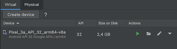
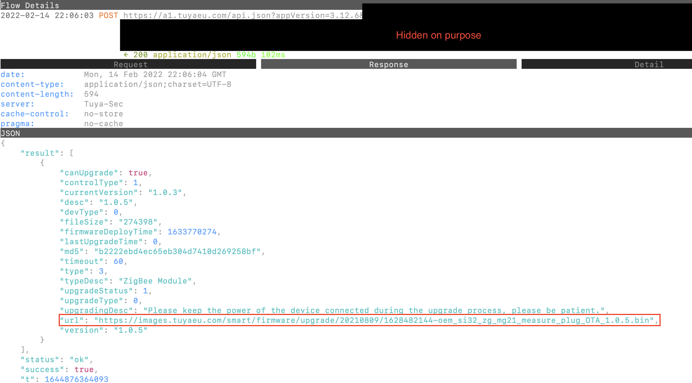

# Get Tuya and Xiaomi OTA url

## Introduction

This guide explains how to obtain firmware update files for Aqara / Xiaomi and Tuya devices.

The scope is to mirror the files on [zigbee-OTA](https://github.com/koenkk/zigbee-ota), so Zigbee2MQTT users can update their devices without the proprietary hub.

If you know there is an update available, but you are unable to follow the steps below, please [open an issue](https://github.com/Koenkk/zigbee-OTA/issues/new) to request the OTA file.

## Notes

A lot of these devices share update identifiers ("manufacturer code" and "image type").  
To prevent conflicts, we must lock each update to the unique "model id" or "manufacturer name".

Some Tuya devices (`TS0601`, datapoint-driven) have 2 MCUs: a Tuya module running the main device logic, and a Zigbee module for networking. Currently, only the Zigbee module can be updated with Zigbee2MQTT.

Aqara updates sometimes have mistakes in the OTA files. This was seen on some switches:  
The update has a wrong "file version", and Zigbee2MQTT thinks it's a downgrade. More info in [this thread](https://github.com/Koenkk/zigbee2mqtt/issues/31318).

## New methods

### Aqara

Tools and information are available in these repositories:

- [absent42/Aqara-Firmware-Archive](https://github.com/absent42/Aqara-Firmware-Archive)
- [absent42/Aqara-Firmware-Query](https://github.com/absent42/Aqara-Firmware-Query)

### Tuya

This method involves reading the logs from a rooted gateway.

**Prerequisites:**

- Mobile device with normal Tuya app
- Tuya device that's not updated yet
- Tuya gateway
- Root access on the gateway ([See this guide for LIDL model](https://paulbanks.org/projects/lidl-zigbee/))

**Steps:**

1. Make sure you can access the console on the gateway OS (via serial or ssh)
2. Connect your device to the gateway (normally, with mobile app)
3. Save (screenshot) the release notes from the mobile app
4. Start the update (it works even if the device is offline)
5. Find the log. The current one is `/tmp/tuya.log`.  
   (Previous logs are archived in `/tuya/log_dir/`)
6. Run this command to search for OTA links in the latest log:  
   `grep fw_url /tmp/tuya.log`  
   (Alternatively, copy the file on your PC via scp or tftp)
7. Try to access the obtained link. It should download the OTA file directly
8. Replace the regional domain with the global address, and make sure it still works. Follow this example:
    - before: `https://ota1-eu.lifeaiot.com:443/smart/firmware/upgrade/20240508/1715138033-tk_common_link_lp_OTA_1.0.13.bin`
    - after: `https://images.tuyaeu.com/smart/firmware/upgrade/20240508/1715138033-tk_common_link_lp_OTA_1.0.13.bin`
9. Submit to zigbee-OTA ([more info below](#submit-the-update-to-zigbee-ota))
10. Enable OTA updates for your model ([more info below](#enable-ota-updates-for-your-model))

## Old method

This method involves intercepting the web traffic of the Android apps, using a proxy.

At least for Tuya, it's obsolete. They block proxies since a ~2020 app update.  
It still works using the old app, but that version does not recognize newer devices, and therefore does not offer updates for them.

Additionally, using Android Studio to emulate ARM (and run the Tuya app) may not be possible anymore.

**Prerequisites:**

- Docker
- Tuya / Aqara gateway
- Device that's not updated yet
- [Android Studio](https://developer.android.com/studio) / spare Android phone
- Old Tuya / Aqara app

### Step 1: running the proxy

Execute the following command: `docker run --rm -it -p 8080:8080 mitmproxy/mitmproxy`

### Step 2: setup the Android emulator

(Or skip this step and take a spare Android phone)

Start Android Studio and create a new empty project:

1. File -> New -> New Project...
1. Phone and Tablet -> Empty Activity -> Next
1. Finish
1. Click on the emulator ("Pixel*3a*..." in the case below) -> Device Manager <br/> 
1. Click on the pencil icon of the device, under "Show Advanced Settings" change the "Internal Storage" to "2000". Click "Finish".
1. Start the emulator by clicking the play icon. <br/> 
1. On the emulator, go to Settings -> Network & internet -> Internet -> AndroidWifi -> Edit (pencil right top) -> Advanced options -> Proxy -> Manual. For proxy host name fill in the IP address of your computer (e.g. 192.168.2.145), for port fill in 8080. Save.
1. Open Chrome on the emulator, go to http://mitm.it and click on "Get mitmproxy-ca-cert.cer" under Android.
1. Go to settings again, Security -> Encryption & credentials -> Install a certificate -> CA certificate -> Install anyway -> Drawer icon -> Downloads -> click on the downloaded certificate.

### Step 3a: get the Tuya OTA url

1. Download the Tuya app apk from [this link](https://www.apkmirror.com/apk/volcano-technology-limited/smart-life-smart-living/smart-life-smart-living-3-12-6-release/smart-life-smart-living-3-12-6-android-apk-download/) (IMPORTANT: newer version don't work, tested with 3.12.6). Drag the downloaded apk on the emulator (which will install it).
1. Open the Tuya Smart Life app in the emulator, log in with your account
1. Make sure the Tuya bridge + the device you want to get the OTA of is already coupled to your account, this cannot be done from the emulator so use your phone for this. Make sure to use the same app on your phone, otherwise the device will not show up (e.g. for iOS use [this](https://apps.apple.com/nl/app/smart-life-smart-living/id1115101477), [**not this**](https://apps.apple.com/nl/app/tuya-smart/id1034649547)).
1. Click on the device -> edit (pencil icon right top). Click "Check for Firmware Upgrade".
1. If a firmware upgrade is available, quickly go back to the output of mitm (step 1), click on the latest request (yes you can click in the console window). This will show your the OTA url (see red box below).
    - Tip: to go back to the overview of requests press the `Q` key on your keyboard.



### Step 3b: get the Xiaomi OTA url

NOTE: This only works for native Aqara gateways which can be connected to the Aqara Home app (not the Xiaomi home app!)

- Works: ZHWG16LM/HE1-G0, ZHWG15LM, ZHWG12LM
- Doesn't work: ZNDMWG03LM, DGNWG02LM

1. Download the Aqara home app apk from [this link](https://apkpure.com/nl/aqara-home/com.lumiunited.aqarahome), tested with version 2.2.5. Drag the downloaded apk on the emulator (which will install it).
1. Open the Aqara home app in the emulator, log in with your account
1. Make sure the Aqara gateway + the device you want to get the OTA of is already coupled to your account, this cannot be done from the emulator so use your phone for this.
1. Click on your device and check for a firmware upgrade.
1. If a firmware upgrade is available, quickly go back to the output of mitm (step 1), click on the latest request (yes you can click in the console window). This will show your the OTA url (see screenshot of step 3a).

## Submit the update to zigbee-OTA

1. Fork [zigbee-OTA](https://github.com/Koenkk/zigbee-OTA) and create a new branch
2. Add the unaltered OTA file, with its original name, to [`/images/Tuya/`](https://github.com/Koenkk/zigbee-OTA/tree/master/images/Tuya) or [`/images/Lumi/`](https://github.com/Koenkk/zigbee-OTA/tree/master/images/Lumi)
3. Commit and create the pull request
4. Add the respective metadata in the PR description. Copy this example and edit accordingly:

````md
```json
{
    "originalUrl": "https://images.tuyaeu.com/smart/firmware/upgrade/20240508/1715138033-tk_common_link_lp_OTA_1.0.13.bin",
    "releaseNotes": "1. Support the first reporting command 0x2C;\r\n2. Supports packet delivery of DP data larger than 64 bytes;\r\n3. Support weather acquisition 0x3A 0x3B;\r\n4. Fix the problem of shortened communication distance;",
    "modelId": "TS0601",
    "manufacturerName": ["_TZE284_2se8efxh"]
}
```
````

If the update is already submitted, just edit [`index.json`](https://github.com/Koenkk/zigbee-OTA/blob/master/index.json).  
Find the respective entry and add your `manufacturerName` to the list.

Refer to [zigbee-OTA readme](https://github.com/Koenkk/zigbee-OTA?tab=readme-ov-file#zigbee-ota) for more details.

## Enable OTA updates for your model

Zigbee2MQTT will not check for updates without OTA enabled in the device definition. You must:

1. Fork [zigbee-herdsman-converters](https://github.com/Koenkk/zigbee-herdsman-converters) and create a new branch
2. Find your model
3. Add `ota: true` to its definition, or `extend: [lumiZigbeeOTA()]`
4. Commit and create the pull request
