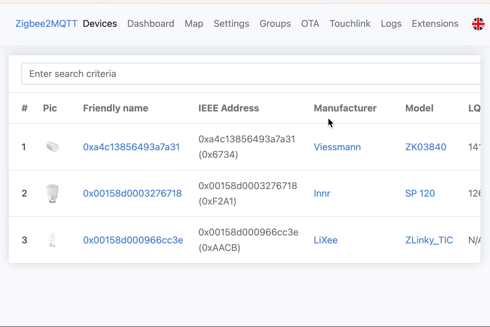

# Support new devices

This page will guide you through the process of adding support for new devices through a temporary [external converter](../../advanced/more/external_converters.md).

In case you require any help feel free to open a [discussion](https://github.com/Koenkk/zigbee2mqtt/discussions).

**Before** starting, first check if your device is not already supported in the Zigbee2MQTT dev branch! This can be done by checking the [changelog](https://gist.github.com/Koenkk/bfd4c3d1725a2cccacc11d6ba51008ba#new-supported-devices) of the dev branch. Also set the Zigbee2MQTT `log_level` to `debug` for easier debugging.

## Instructions

### 1. Pairing the device with Zigbee2MQTT

The first step is to pair the device with Zigbee2MQTT. It should be possible to pair your unsupported device out of the box because Zigbee2MQTT can pair with any Zigbee device. You need to find out how to bring your device into pairing mode, most of the time via a factory reset.

Once you successfully paired the device you will see something like this in the logs:

```
Zigbee2MQTT:info  2019-11-09T12:19:56: Successfully interviewed '0x00158d0001dc126a', device has successfully been paired
Zigbee2MQTT:warn  2019-11-09T12:19:56: Device '0x00158d0001dc126a' with Zigbee model 'lumi.sens' and manufacturer name 'some_name' is NOT supported, please follow https://www.zigbee2mqtt.io/how-tos/support_new_devices.html
```

> [!TIP]
> Make sure that joining is enabled, otherwise new devices cannot join the network.

### 2. Creating the external definition

When pairing an unsupported device with Zigbee2MQTT, it will attempt to discover features supported by this device. To check what has already been discovered, navigate to the `Exposes` tab of the device in frontend. See if the exposed features work by checking if values are reported and/or states are controllable (in case of e.g. a light).
Note that feature discovery is still WIP, not all features may be discovered, some may not be discoverable at all due to a non-standard implementation on the device (commonly the case for Tuya devices).

To see the code for the discovered features, navigate to the `Dev console` tab of the device and press `Generate external definition`.



By default, the external definition will map exposed Zigbee clusters to features according to the Zigbee ZCL specification. Of course, if the device does not conform to the specification, it may not work properly or at all.
If all features work and all expected features are present, you are lucky and can skip to step 3.
If not, you will have to extend the external definition.

> [!TIP]
> Depending on the device, it may be possible to extend the definition using other modern extends.
> This is the recommended process as it is generally easier.

### 3. Extending the generated external definition

To extend the generated external definition, you can either save the code in a file manually, and restart Zigbee2MQTT, or you can use the MQTT API / frontend to load the converter at runtime. See [external converters](../../advanced/more/external_converters.md) for more details.

Add and/or configure the appropriate modern extends for the device (see previous link).

A minimal definition should contain:

- Exact identifiers, for device detection (`zigbeeModel` or `fingerprint`)
- Product branding, for the user (`model`, `vendor`, `description`). _The model must be unique, e.g. `ZY-M100-24GV3`_
- Device features (Use `extend` functions. They bundle `fromZigbee`, `toZigbee`, `exposes` etc.)

> [!TIP]
> The `Clusters` tab of the device, in frontend, lists supported clusters for further analysis.

Once done, trigger actions on the device.

If your device is not reporting anything, it could be that this device requires additional configuration. This can be done by adding a `configure:` section. _It may help to look at similar [devices](https://github.com/Koenkk/zigbee-herdsman-converters/blob/master/src/devices)._

> [!TIP]
> If your device is advertised as Tuya compatible or reports anything with `manuSpecificTuya`, additional instructions for adding your device can be found [here](./02_support_new_tuya_devices.md).

If you still see messages like below after adding and configuring all appropriate modern extends, you may need to add specific converters that modern extends do not provide. Existing converters can probably be reused, those can be found [here](https://github.com/Koenkk/zigbee-herdsman-converters/blob/master/src/converters/fromZigbee.ts).

```
Zigbee2MQTT:debug  2019-11-09T12:24:22: No converter available for 'WSDCGQ01LM' with cluster 'msTemperatureMeasurement' and type 'attributeReport' and data '{"measuredValue":2512}'
```

For the above message, you would use the already existing `fz.temperature` converter:

```js
    fromZigbee: [fz.temperature],
```

_Note: This converter would actually be covered by the appropriate modern extend (`temperature()`), it is just given as an example. See [more examples](../../advanced/more/external_converters.md#more-examples)._

Repeat this last step until your device no longer produces log messages like `No converter available for 'WSDCGQ01LM' with cluster...`

If none of the existing converters fit, you can add custom ones, an example for this can be found [here](https://github.com/Koenkk/zigbee2mqtt.io/blob/master/docs/externalConvertersExample/freepad_ext.mjs).

### 4. Create a pull request

To contribute your new device definition to Zigbee2MQTT such that it will be supported out-of-the-box in the next release, follow these steps:

1. Make sure the device was not already added/submitted
2. Identify the correct [devices file](https://github.com/Koenkk/zigbee-herdsman-converters/tree/master/src/devices) in the zigbee-herdsman-converters repository where your device belongs (usually by brand or vendor).
3. Click on the file and use the edit (pencil) icon to open it for editing directly on GitHub.
4. Add your device definition to the file, following the structure and patterns used for similar devices.
5. Press **Commit changes** -> **Propose changes** -> **Create pull request**.
6. Fill in the PR template and press **Create pull request**.

### 5. (Optional) Add device notes to zigbee2mqtt.io documentation

Create a pull request to the [zigbee2mqtt.io repository](https://github.com/Koenkk/zigbee2mqtt.io) adding a markdown file for your device to `docs/devices`, use the `model` property of your definition as the filename. Most of the contents of this file will be auto-generated through docgen but you can add your own notes in a notes section.

Do not use `h1` or `h2` headings within the `## Notes`-Section.

> > \<!-- Notes BEGIN --><br> >> \## Notes<br>
> > ...<br> >> \<!-- Notes END -->
