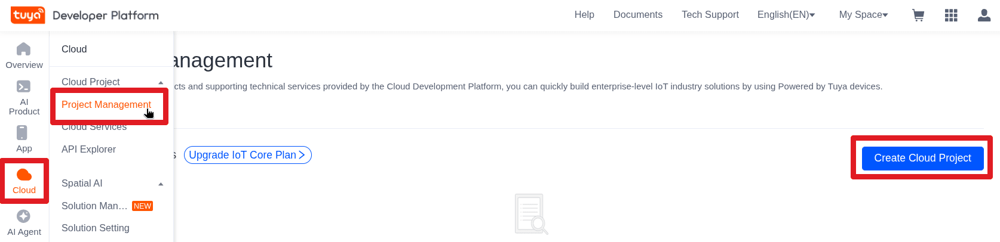
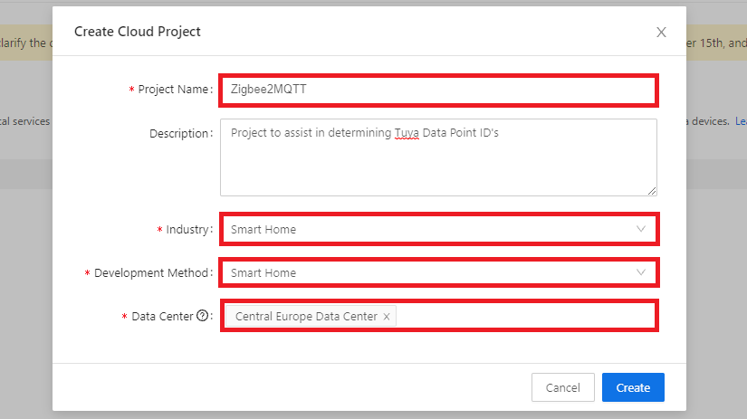
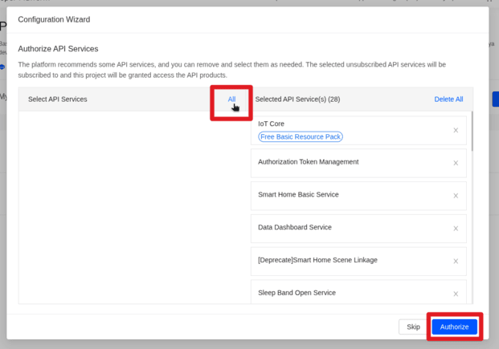
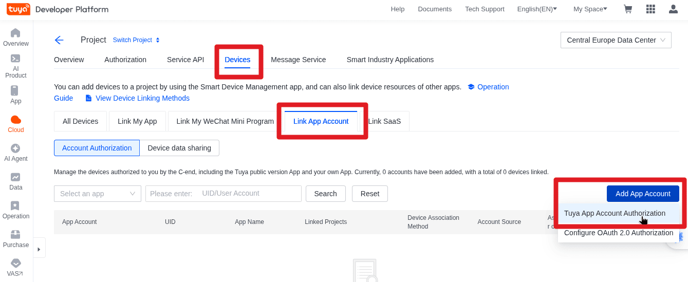
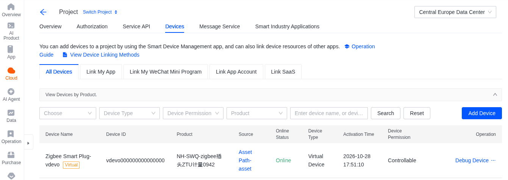
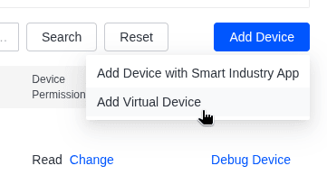
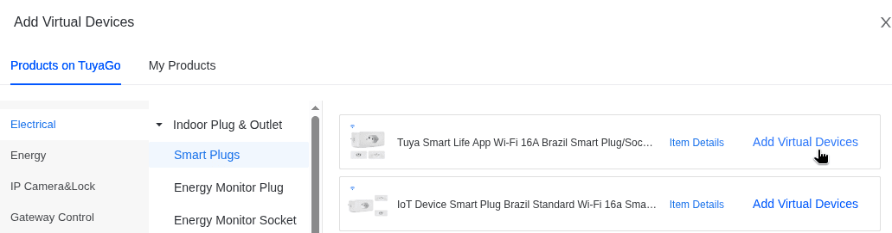
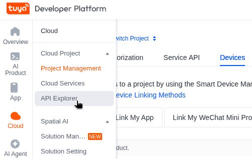
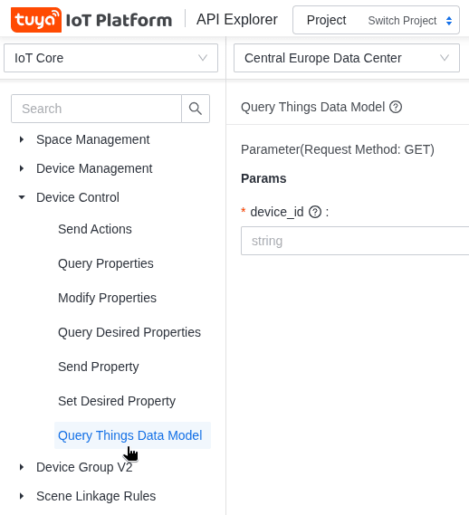

# Find Tuya Data Points

## Introduction

Some Tuya devices (typically `TS0601`) work entirely through the custom `manuSpecificTuya` cluster.  
Each device function is mapped to a datapoint ID, reported through this cluster.  
(More info on the previous page: [Support new Tuya devices](./02_support_new_tuya_devices.md))

**The instructions below will help you use the Tuya IoT Platform to obtain the feature schema of a product**.  
The "model" contains a list of datapoints (features), with their respective IDs, data-types etc. This schema is required to fully support the device.

There are 3 steps: set-up the accounts, add the device and export the schema.

_Alternatively, you can ask the manufacturer / vendor for the "UART protocol" or "serial protocol" of the device._

## Requirements

1. Internet access
2. web browser
3. mobile Tuya app (stock app or vendor clone)
4. Tuya account (logged in to the app)
5. Tuya developer account (logged in to the website)
6. one of the following:
    - physical access to a Tuya Zigbee gateway and the device in question
    - or just the product ID (last 8 chars of the Zigbee manufacturer)  
      e.g: `TS0601` `_TZE284_0kihjsys` -> PID is `0kihjsys`

## Set-up mobile app and web platform

### 1. Install the mobile app

Download the Tuya app on a mobile device, create an account and log in.

### 2. Sign up for Tuya IoT Platform

The Tuya IoT Platform is the backbone for how internet-connected Tuya devices communicate back to the Tuya platform.  
It contains a suite of Application Programming Interfaces (APIs) which allow for developers to embed the Tuya functionality within their own platforms.

**Visit [Tuya IoT Platform](https://iot.tuya.com/) and sign up** for a developer account.  
_This is a different account than what the mobile apps use._

### 3. Log in as Individual Developer

Use your new credentials to **login to the Tuya IoT Platform**. You will be greeted with a first time tutorial showing you around the platform.  
At the end of the tutorial select **Individual Developer**. If you miss this, click on the person icon in the top-right -> **Account** and set **Account Type** to **Individual Developer**.

### 4. Create a cloud project

Click on **Cloud** in the side menu -> **Project Management**. On this page click on **Create Cloud Project**.



In the newly opened dialog box, fill in the details as required, enduring that the **Development Method is selected as Smart Home**, and the **Data Center corresponds to the region that your Tuya account is associated with.**



The next page is Configuration Wizard. Click **Select API Services** -> **All**, then **Authorize**.



Once confirmed, you should be taken to your new Tuya project.

### 5. Link the app with the cloud project

Click on **Devices** -> **Link App Account** -> **Add App Account** -> **Tuya App Account Authorization**.



This should bring up a QR code.  
On the Tuya mobile app, tap on `+` **Add** -> `[-]` **Scan**. Give camera permissions, scan the code, and press **Confirm login**.  
On your computer, a **Link App Account** window will pop-up. Set **Device Linking Method** to **Automatic Link** and click **Ok**.  
When successful, you will see a list of already-added devices; close it.

## Add devices

To see all devices associated with the project, make sure you are on this page:  
Cloud -> Project Management -> Open project -> **Devices** -> **All Devices**.



There are multiple ways of adding devices (real or virtual).

_If the following methods don't work (the device list remains empty), check the project region._

### A. Real device

If you have a Tuya gateway and the physical device:

1. Set-up the Zigbee gateway in the Tuya app
2. Pair the device normally
3. Refresh the web page

### B. Virtual device

Without a Tuya gateway, we can create virtual devices. **We only need the product ID.**

1. Pair the device to Zigbee2MQTT to get the **Zigbee manufacturer**

2. Obtain its **product ID** by taking the last 8 characters of the Zigbee manufacturer  
   e.g: `TS0601` `_TZE284_0kihjsys` -> PID is `0kihjsys`

3. Click **Add Device** -> **Add Virtual Device**

    

4. Select a random product and click **Add Virtual Devices**

    

5. Click on **Add to Tuya App Account** tab.  
   This generates a temporary QR code for that device.

6. **Scan the QR code with a normal scanner** and copy the output.  
   It looks like this _(and it's tied to your account)_:

    `tuyaSmart--addVirtualDev?productId=abcdefgh&token=...&biz=spider`

7. **Edit the text**: Replace the selected PID with the one of your device, e.g:

    `productId=abcdefgh` -> `productId=0kihjsys`

8. **Generate a new QR code** with the resulted text:

    `tuyaSmart--addVirtualDev?productId=0kihjsys&token=...&biz=spider`

9. Finally **scan the new QR code with the Tuya app:**  
   Tap on `+` **Add** -> `[-]` **Scan**. The device should appear immediately

10. On the computer, go back to the device list, and refresh the page if needed

## Export the schema

After adding the device, you can play around and "debug" it.  
But that's not very useful, so we'll skip straight to exporting the schema.

There are multiple methods:

### A. Command line

1. Clone and install [tuya-smart-control-cli](https://github.com/tuya/tuya-smart-control-cli)
2. Run `tuya init` and input your API key (e.g. from [eu.tuya.ai/apps/keys](https://eu.tuya.ai/apps/keys))
3. Run `tuya device list` to find your device ID
4. Run `tuya device model --json device_id > schema.json` to export the schema

### B. Web

1. Copy the **Device ID** from the list of devices.  
   (full path: Cloud -> Project Management -> Open project -> **Devices** -> **All Devices**)

2. Go to **Cloud** -> **API Explorer**

    

3. Go to **IoT Core** -> **Device Control** -> **Query Things Data Model**

    

4. Input the Device ID and click **Submit Request**

5. The `model` field from the response should contain the full schema.  
   (Remove the back-slashes `\` and format it for easier reading)

    ```json
     {
         "modelId": "000003n1s4",
         "services": [
             {
                 "actions": [],
                 "code": "",
                 "description": "",
                 "events": [],
                 "name": "默认服务",
                 "properties": [
                     {
                         "abilityId": 1,
                         "accessMode": "rw",
                         "code": "switch_1",
                         "description": "",
                         "extensions": {
                             "iconName": "icon-power",
                             "attribute": "641"
                         },
                         "name": "开关1",
                         "typeSpec": {
                             "type": "bool"
                         }
                     },
                     ...
                 ]
             }
         ]
     }
    ```
