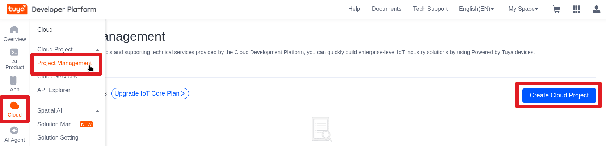
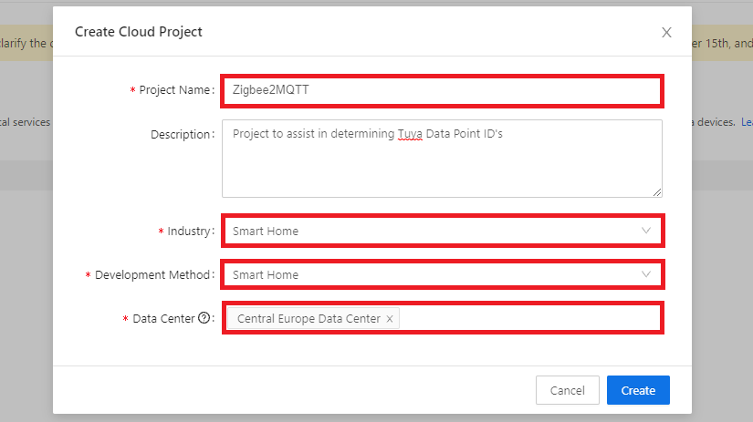
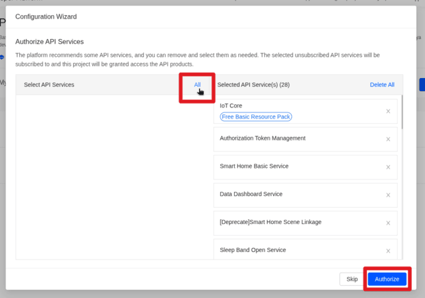
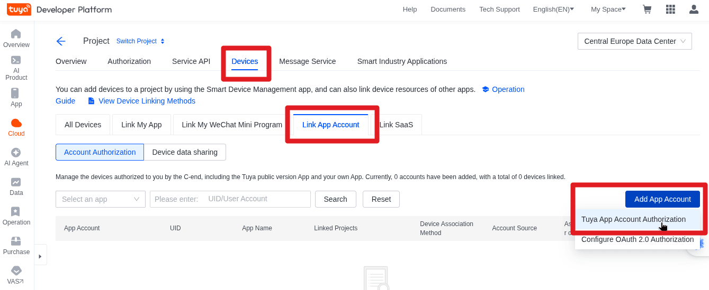
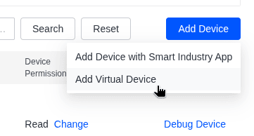
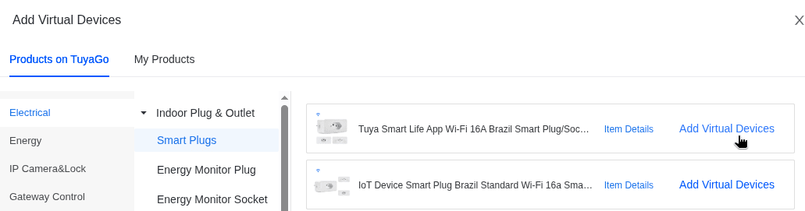
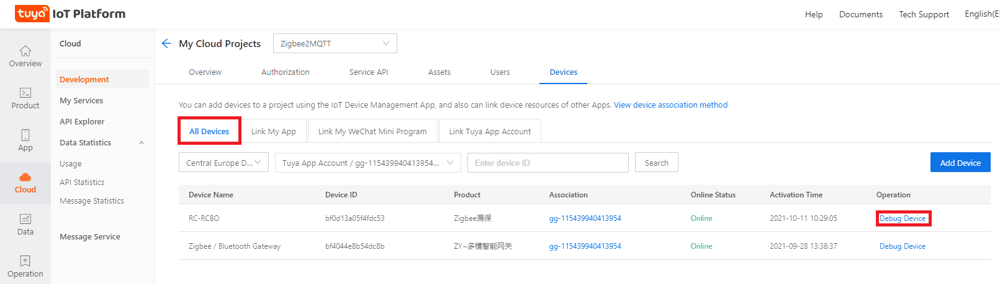
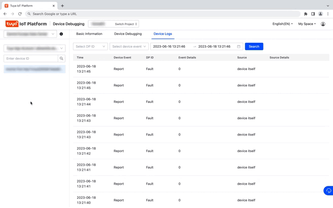
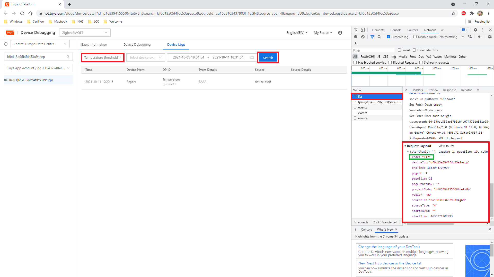

# Find Tuya Data Points

## Introduction

Some Tuya devices (typically `TS0601`) use a custom `manuSpecificTuya` cluster.  
Each device function is mapped to a datapoint ID, reported through this cluster.  
(More info on the previous page: [Support new Tuya devices](./02_support_new_tuya_devices.md))

**The instructions below will help you use the Tuya IoT Platform to obtain the feature schema of a product**: the list of datapoints (features), with their respective IDs and data types. This schema is required to fully support the device.

_Alternatively, you can ask the manufacturer / vendor for the "UART protocol" or "serial protocol" of the device._

## Requirements

1. modern browser with Internet access (instructions are for Chrome, desktop)
2. access to the browser console / dev tools
3. mobile Tuya app (stock app or vendor clone)
4. Tuya account (logged in to the app)
5. Tuya developer account (logged in to the website)
6. One of the following:
    - physical access to a Tuya Zigbee gateway and the device in question
    - or just the product ID (last 8 chars of the Zigbee manufacturer)  
      e.g: `TS0601` `_TZE284_0kihjsys` -> PID is `0kihjsys`

## Set-up mobile app and web platform

### 1. Install the mobile app

Download the Tuya app, create an account and log in.

### 2. Sign up for Tuya IoT Platform

The Tuya IoT Platform is the backbone for how internet-connected Tuya devices communicate back to the Tuya platform.  
It contains a suite of Application Programming Interfaces (APIs) which allow for developers to embed the Tuya functionality within their own platforms.

**Visit [Tuya IoT Platform](https://iot.tuya.com/) and sign up** for a developer account.  
_This is a different account than what the mobile apps use._

### 3. Log in as Individual Developer

Use your new credentials to **login to the Tuya IoT Platform**. You will be greeted with a first time tutorial showing you around the platform.  
At the end of the tutorial select **Individual Developer**. If you miss this, click on the person icon in the top-right -> **Account** and set **Account Type** to **Individual Developer**.

### 4. Create a cloud project

Click on **Cloud** in the side menu -> **Project Management**. On this page click on **Create Cloud Project**.



In the newly opened dialog box, fill in the details as required, enduring that the **Development Method is selected as Smart Home**, and the **Data Center corresponds to the region that your Tuya account is associated with.**



The next page is Configuration Wizard. Click **Select API Services** -> **All**, then **Authorize**.



Once confirmed, you should be taken to your new Tuya project.

### 5. Link the app with the cloud project

Click on **Devices** -> **Link App Account** -> **Add App Account** -> **Tuya App Account Authorization**.



This should bring up a QR code.  
On the Tuya mobile app, tap on `+` **Add** -> `[-]` **Scan**. Give camera permissions, scan the code, and press **Confirm login**.  
On your computer, a **Link App Account** window will pop-up. Set **Device Linking Method** to **Automatic Link** and click **Ok**. (If prompted, set Device Permission to: Read, write, and Manage).  
When successful, You will see a lits the of devices already added, close it.

## Add devices

Click on **Devices** -> **All Devices**.  
Now there are multiple ways of adding devices to the cloud project.

_If the following methods don't work (the device list remains empty), check the project region._

### Real device

If you have a Tuya gateway and the physical device:

1. Download the Tuya app, create an account and log in
2. Set-up the Zigbee gateway and pair the device normally
3. Refresh the web page

### Virtual device

Without a Tuya gateway, we can create virtual devices.  
**We only need the product ID.**

1. Pair the device to Zigbee2MQTT to get the **Zigbee manufacturer**

2. Obtain its **product ID** by taking the last 8 characters of the Zigbee manufacturer  
   e.g: `TS0601` `_TZE284_0kihjsys` -> PID is `0kihjsys`

3. Click **Add Device** -> **Add Virtual Device**

    

4. Select a random product and click **Add Virtual Devices**

    

5. Navigate to **Add to Tuya App Account**

6. Scan the QR code with a normal scanner and copy the output.  
   It looks like this _(and it's tied to your account)_:

    `tuyaSmart--addVirtualDev?productId=abcdefgh&token=...&biz=spider`

7. Edit the text: Replace the selected PID with the one of your device, e.g:

    `productId=abcdefgh` -> `productId=0kihjsys`

8. Generate a new QR code with the resulted text

9. Finally scan the new QR code with the Tuya app: Tap on `+` **Add** -> `[-]` **Scan**. The device should appear immediately

10. On the computer, go back to the device list and refresh the page if needed

## Debug device

Now that you have the device in the cloud project, you can "debug" it:  
In **Devices** -> **All Devices**, click on **Debug Device**.



1. In the **Device Debugging** tab, you will see the _(usually incomplete)_ schema, under **Standard Instruction Set** _(read-write)_ and **Standard Status Set** _(read-only)_. This gives you the type, scale and range of some data, but it's missing the datapoint IDs

2. In the **Device Logs** tab, you will see list of all events the device has sent to the Tuya platform. The source code of this tab includes the datapoints IDs

_Note the exact feature naming usually differs from one tab to the other._

### Export the IDs automatically

On the **Device Logs** tab, open the **browser menu** -> **More tools** -> **Dev tools** -> **Console**. Paste the [code below](#automatic-script) and press `Enter`. Next, open the **Select DP ID** drop-down list and hover over each item. The running code will automatically read the datapoint ID for each item. When finished, run `export_codes()` in the console. This will output the feature×ID mapping.



#### Automatic script

> [!WARNING]
> Never run code that you do not understand. It is your responsibility to ensure that you understand what the code is doing before running it.

The code of the selected/hovered data point ID in the drop-down list as well as the previous and the next IDs are stored in the DOM under `<div id="code_list">`. The code below fetches these three codes each time the div is updated and stores them in the dictionary `codes`.

```javascript
function waitForElm(selector) {
    /** Wait for an HTML element to appear in the DOM.
     *
     * Answer of Yong Wang (https://stackoverflow.com/users/4556536/yong-wang) to
     * https://stackoverflow.com/questions/5525071/how-to-wait-until-an-element-exists
     */
    return new Promise((resolve) => {
        if (document.querySelector(selector)) return resolve(document.querySelector(selector));

        const observer = new MutationObserver((mutations) => {
            if (document.querySelector(selector)) {
                resolve(document.querySelector(selector));
                observer.disconnect();
            }
        });

        observer.observe(document.body, {childList: true, subtree: true});
    });
}

let codes_selector = '#code_list';
let codes = {};

// Wait for the code list to appear in the DOM.
waitForElm(codes_selector).then((elm) => {
    // Create an observer to watch for changes and update the codes dictionary.
    var observer = new MutationObserver((mutations) => {
        let code_items = document.getElementById('code_list').getElementsByTagName('div');
        for (const code_item of code_items) {
            codes[code_item.textContent] = code_item.getAttribute('aria-label');
        }
    });

    observer.observe(document.querySelector(codes_selector), {childList: true});
});

function export_codes() {
    /** Export the codes dictionary to the console in a copy-friendly format. */
    let codes_str = JSON.stringify(codes);
    console.log(codes_str);
}
```

### Find the IDs manually

On the **Device Logs** tab, select a datapoint in the drop-down list, above the events table.  
Open the **browser menu** -> **More tools** -> **Dev tools** -> **Network**.  
Then click the **Search** button in the Tuya IoT Platform window.



You should see a number of calls appear in the **Name** section.  
Click the `list` call -> **Payload** -> **Request Payload**. There is a json object which contains all data sent by the search function. The key labelled `code` is the datapoint ID!  
Repeat for all datapoints in the drop-down list.
